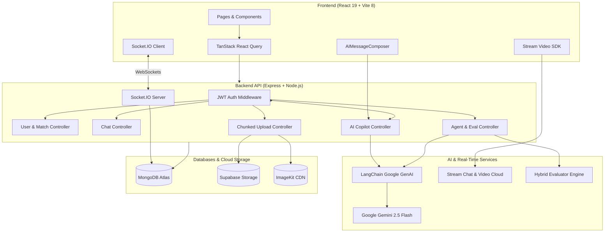

# 🎙️ Streamophone

> **A Next-Generation Language Exchange, Real-Time Video Calling & AI Immersion Platform**

Streamophone bridges the gap between passive language learning and fluent conversation. It pairs learners around the globe for real-time tandem exchange over high-definition video and interactive chat, augmented with an in-composer AI writing copilot and custom autonomous AI language partners with automated behavioral evaluation.

---

## 📑 Table of Contents

- [Overview](#-overview)
- [Key Features](#-key-features)
- [System Architecture](#-system-architecture)
- [Data Flow & Mechanisms](#-data-flow--mechanisms)
  - [Language Compatibility Algorithm](#1-smart-language-matching-algorithm)
  - [Real-Time Messaging & Sockets](#2-real-time-messaging-pipeline)
  - [In-Chat AI Writing Copilot](#3-in-chat-ai-writing-copilot)
  - [AI Agent Engine & Hybrid Evaluation](#4-ai-agent-engine--hybrid-evaluation)
- [Frontend Routes & Component Architecture](#-frontend-routes--component-architecture)
- [Backend Route Mechanics & API Deep Dive](#-backend-route-mechanics--api-deep-dive)
  - [1. Authentication Routes (`/api/auth`)](#1-authentication-routes-apiauth)
  - [2. User & Discovery Routes (`/api/user`)](#2-user--discovery-routes-apiuser)
  - [3. Chat & Video Token Routes (`/api/chat`)](#3-chat--video-token-routes-apichat)
  - [4. In-Chat AI Assistant Routes (`/api/ai`)](#4-in-chat-ai-assistant-routes-apiai)
  - [5. AI Agent & Evaluation Routes (`/api/agents`)](#5-ai-agent--evaluation-routes-apiagents)
  - [6. Media & Chunked Upload Routes (`/api/upload`)](#6-media--chunked-upload-routes-apiupload)
- [Frontend ⇄ Backend Integration Matrix](#-frontend--backend-integration-matrix)
- [Tech Stack](#-tech-stack)
- [Directory Structure](#-directory-structure)
- [Socket.IO Events Reference](#-socketio-events-reference)
- [Environment Variables](#-environment-variables)
- [Getting Started](#-getting-started)
- [Known Gotchas & Architecture Notes](#-known-gotchas--architecture-notes)
- [Roadmap](#-roadmap)
- [License](#-license)

---

## 🌟 Overview

Traditional language applications rely heavily on repetitive flashcards and pre-recorded dialogues, leaving learners unprepared for spontaneous conversation. **Streamophone** solves this by providing:

1. **Human Tandem Exchange**: Connecting users whose native and learning languages complement each other (e.g., an English speaker learning Japanese paired with a Japanese speaker learning English).
2. **In-Flight AI Assistance**: An in-chat writing assistant powered by Google Gemini that helps learners draft, translate, polish grammar, or adjust tone without ever leaving the conversation.
3. **Autonomous AI Practice Agents**: 24/7 personalized AI conversational partners tailored to specific learning objectives, languages, and strict pedagogical rules.
4. **Behavioral Evaluation Suite**: A hybrid evaluation pipeline that runs automated test suites against AI agents using both deterministic code checks and LLM-as-a-judge assessments.

---

## ✨ Key Features

### 🤝 1. Smart Language Partner Matching
- **Reciprocal Compatibility Scoring**: Computes match scores up to 100% based on complementary native/learning language pairs, location proximity, and activity status.
- **Dynamic Exploration & Filters**: Filter potential practice partners by native language, learning language, and geographic location.
- **Friend Request Workflow**: Send, receive, accept, and manage language exchange invitations with real-time notification badges.

### 📹 2. 1:1 HD Video Calling
- **Stream Video SDK Integration**: Seamless browser-to-browser WebRTC video calls powered by `@stream-io/video-react-sdk`.
- **Integrated Call Controls**: Camera toggle, microphone mute, speaker layout, and instant call disconnection.
- **Direct Call Link Sharing**: Launch a video room directly from a chat session.

### 💬 3. Dual Real-Time Chat Infrastructure
- **Socket.IO Real-Time Engine**: Custom persistent messaging pipeline with typing indicators, online/offline presence tracking, and MongoDB persistence.
- **Stream Chat Support**: Compatible with `stream-chat-react` (v14) using backend user token minting.
- **Multimedia Messages**: Send text, images, and video attachments with preview rendering.

### 🤖 4. In-Chat AI Writing Assistant (Copilot)
Directly integrated into the message composer:
- **🌐 Translate**: Instantly translates the current draft into the recipient’s native language.
- **✨ Improve**: Enhances phrasing, corrects grammar, and optimizes natural vocabulary.
- **😊 Friendly**: Rewrites the text in a warm, welcoming, and casual tone.
- **💼 Formal**: Rewrites the text in a polite, structured, and professional tone.

### 🧠 5. Custom AI Language Partners & Evaluator
- **Custom Agent Builder**: Create agents with custom objectives, target languages, conversational tones, and custom behavioral rules.
- **Real-Time Agent Chat**: Converse with custom agents over WebSockets with conversation memory tracking.
- **Hybrid Evaluation Suite**: Run automated test cases to evaluate agent compliance against defined behaviors (e.g. *"ask exactly one question per turn"*, *"correct mistakes politely"*), generating pass/fail scores and detailed reasoning.

### ⚡ 6. Chunked Media Upload Pipeline
- **Large File Support**: Chunked upload controller supporting video files with Multer and Supabase Storage / ImageKit.
- **Video Streaming**: Byte-range delivery and manifest reconstruction for smooth media playback.

### 🎨 7. Modern UI & Dual Theming
- **Tailwind CSS 4 & daisyUI 5**: Built using OKLCH color spaces.
- **Dual Themes**: Default sleek dark theme (`mytheme`) and crisp light theme (`whats`).
- **Dicebear Avatars**: Diverse, expressive avatar generation for learner profiles.

---

## 🏛️ System Architecture



---

## 🔬 Data Flow & Mechanisms

### 1. Smart Language Matching Algorithm
When a user requests recommended partners (`GET /api/user/recommended`), the backend queries candidate users excluding current friends and computes a weighted compatibility score:

| Match Condition | Score Weight | Description |
| :--- | :---: | :--- |
| **Reciprocal Match** | `+80 pts` | User A native = User B learning **AND** User A learning = User B native |
| **Native Speaker Match** | `+50 pts` | Partner is a native speaker of what you are learning |
| **Learning Match** | `+30 pts` | Partner is learning your native language |
| **Peer Co-Learner** | `+20 pts` | Partner is learning the same target language |
| **Shared Native Tongue**| `+20 pts` | Partner shares your native language |
| **City / Location Match**| `+10 pts` | Partner is in the same city |
| **Activity Status** | `+10 pts` | User is currently online or recently active |

The system sorts candidate users by total score and presents them with intuitive star ratings (30–100%).

---

### 2. Real-Time Messaging Pipeline
1. **Authentication**: During WebSocket handshake, Socket.IO extracts the HTTP-only JWT cookie, verifies it, and attaches the authenticated user model to `socket.user`.
2. **Online Presence**: User sockets are mapped in `socketStore.js`. Online users are broadcast to peers on connection and disconnection.
3. **Chat Exchange**:
   - Client emits `send-message` with text, receiver ID, and optional media attachments.
   - Server validates friendship status, persists the message in MongoDB, updates the conversation's `lastMessage`, and routes `receive-message` to all active sockets of the recipient.
4. **Typing Indicators**: Ephemeral `typing` and `stop-typing` events stream between active partner sessions.

---

### 3. In-Chat AI Writing Copilot
The AI message composer interacts directly with the input draft without disrupting the chat window:

```
[User Draft] ──> [useAI Hook] ──> [POST /api/ai/:action] ──> [LangChain Prompt] ──> [Gemini 2.5]
                                                                                            │
[Composer Input Replaced] <── [Updated Draft Text] <── [Formatted Output] <─────────────────┘
```

Available actions:
- `/api/ai/translate`: Translates text between authenticated user's native tongue and the peer's target language.
- `/api/ai/improve`: Refines phrasing, vocabulary, and grammar.
- `/api/ai/friendly`: Softens expressions to sound warm and casual.
- `/api/ai/formal`: Converts slang and informal phrases into polite, professional phrasing.

---

### 4. AI Agent Engine & Hybrid Evaluation
Learners can create specialized AI agents (e.g. *"Tokyo Barista"*, *"DELE Exam Prep Tutor"*). 

```
                                 ┌──────────────────────────────────────────────┐
                                 │              User Creates Agent              │
                                 │   (Objective, Target Language, Behaviors)    │
                                 └──────────────────────┬───────────────────────┘
                                                        │
                         ┌──────────────────────────────┴──────────────────────────────┐
                         ▼                                                             ▼
             [Interactive Agent Chat]                                       [Automated Agent Testing]
             • Socket.IO: `send-agent-message`                               • POST /api/agents/tests/run
             • Context History loaded from DB                               • Evaluates agent output across test cases
             • LangChain generates assistant reply                          • Hybrid evaluation step:
             • Stored & emitted back to client                                   ├── Deterministic Checks (Regex/Code)
                                                                                 └── LLM-as-a-judge (Gemini structured JSON)
                                                                            • Returns Pass/Fail, score & reasons
```

#### Deterministic vs LLM Evaluation
- **Deterministic**: Fast, rule-based algorithmic verification (e.g. validating that the agent asked *exactly one question* per turn using regex sentence splitting).
- **LLM-as-a-Judge**: Evaluates semantic behavior (e.g. conversational tone, patience, vocabulary appropriateness) returning structured JSON containing scores, pass/fail flags, and explicit rationale.

---

## 🖥️ Frontend Routes & Component Architecture

The frontend application uses **React Router v8** and is structured around two key gatekeeper states:
1. `isAuthenticated`: Determined by querying `GET /api/auth/me` via the `useAuthUser` hook.
2. `isOnboarded`: Checks whether the user has completed their profile setup (`nativeLanguage`, `learningLanguage`, `profilePic`).

### Global Route Guard Structure (`frontend/src/App.jsx`)
```jsx
// Unauthenticated  ──> Redirect to /login
// Not Onboarded    ──> Redirect to /onboarding
// Fully Authenticated & Onboarded ──> Render inside <Layout showSidebar={true}>
<Route
  path="/"
  element={
    isAuthenticated && isOnboarded ? (
      <Layout showSidebar={true}><HomePage /></Layout>
    ) : (
      <Navigate to={isAuthenticated ? "/onboarding" : "/login"} replace />
    )
  }
/>
```

### Route-by-Route Breakdown

#### 1. `Route /` ➔ `HomePage.jsx`
- **Access Rule**: Authenticated & Onboarded.
- **Purpose**: Community discovery dashboard where learners explore potential language partners.
- **Under the Hood**:
  - Uses TanStack Query to fetch `getUserFriends` (`/api/user/friends`), `getRecommendedUsers` (`/api/user/recommended`), and `getOutgoingFriendReqs`.
  - Supports live filtering via `getExploreUsers` (`/api/user/explore`) by native language, learning language, and location.
  - Computes star ratings (`⭐⭐⭐⭐⭐` to `⭐☆☆☆☆`) based on the calculated compatibility score.
  - Allows immediate friend requests via `sendFriendRequest(userId)`.

#### 2. `Route /login` ➔ `LoginPage.jsx`
- **Access Rule**: Unauthenticated only (redirects to `/onboarding` if already authenticated).
- **Purpose**: Secure sign-in form for existing users.
- **Under the Hood**:
  - Submits credentials (`email`, `password`) via `loginMutation` calling `POST /api/auth/signin`.
  - On success, invalidates the `["authUser"]` cache, causing React Query to refetch `/api/auth/me`.
  - Because cookies are `HTTP-Only`, authentication state is stored securely in the browser session without exposing tokens to JavaScript.

#### 3. `Route /signup` ➔ `SignupPage.jsx`
- **Access Rule**: Unauthenticated only.
- **Purpose**: New user account registration.
- **Under the Hood**:
  - Collects `fullName`, `email`, and `password`.
  - Submits data via `signupMutation` to `POST /api/auth/signup`.
  - Automatically redirects newly created users directly to the `/onboarding` screen to set their language learning preferences.

#### 4. `Route /onboarding` ➔ `OnBoardPage.jsx`
- **Access Rule**: Authenticated only.
- **Purpose**: Personalized language setup and avatar generator.
- **Under the Hood**:
  - Lets users choose their `nativeLanguage`, `learningLanguage`, `location`, and short `bio`.
  - Includes an avatar picker that generates SVG avatars using Dicebear (`@dicebear/adventurer` & `@dicebear/open-peeps`).
  - Calls `POST /api/auth/onboarding`. Upon success, sets `isOnboarded = true` and redirects to `/`.

#### 5. `Route /chat/:id` ➔ `ChatPage.jsx`
- **Access Rule**: Authenticated & Onboarded.
- **Purpose**: 1:1 real-time chat interface with language partners.
- **Under the Hood**:
  - Extracts friend user ID via `useParams()`.
  - Loads chat history and friend metadata using `useChat(friendId)` (`GET /api/chat/:friendId`).
  - Emits real-time messages via `socket.emit("send-message", { receiverId, text, type, attachments })`.
  - Subscribes to incoming messages via `useSocket({ "receive-message": handleReceive })`, immediately updating the TanStack Query cache.
  - Supports image and video uploads using `uploadImage()` with live progress percentage callbacks.
  - Hosts `AIMessageComposer` which connects to the AI copilot.

#### 6. `Route /call/:id` ➔ `CallPage.jsx`
- **Access Rule**: Authenticated & Onboarded.
- **Purpose**: 1:1 WebRTC Video calling screen.
- **Under the Hood**:
  - Extracts `callId` from URL route params.
  - Queries `getStreamToken` (`GET /api/chat/token`) to authenticate with Stream's edge network.
  - Instantiates `StreamVideoClient` with `STREAM_API_KEY`, user credentials, and the minted Stream token.
  - Joins the video call via `callInstance.join({ create: true })`.
  - Renders `StreamTheme`, `SpeakerLayout`, and `CallControls`. When call terminates, automatically redirects user back to `/`.

#### 7. `Route /notifications` ➔ `NotificationPage.jsx`
- **Access Rule**: Authenticated & Onboarded.
- **Purpose**: Friend request center.
- **Under the Hood**:
  - Queries `getFriendRequests` (`GET /api/user/friend-requests`) and `getOutgoingFriendReqs`.
  - Allows users to accept pending requests via `acceptFriendRequestMutation` (`PUT /api/user/friend-request/:id/accept`).
  - Displays user profile cards with language tags and connection timestamps.

#### 8. `Route /friends` ➔ `FriendsPage.jsx`
- **Access Rule**: Authenticated & Onboarded.
- **Purpose**: Directory of all accepted language practice partners.
- **Under the Hood**:
  - Calls `getUserFriends` (`GET /api/user/friends`).
  - Renders interactive partner cards displaying native/learning language badges, online presence indicators, direct "Message" buttons, and "Start Call" triggers.

#### 9. `Route /agents` ➔ `Agent.jsx`
- **Access Rule**: Authenticated & Onboarded.
- **Purpose**: AI Agent Studio for creating and managing autonomous language partners.
- **Under the Hood**:
  - Queries `getAgents` (`GET /api/agents`) to display all user-created conversational agents.
  - Form modal to create agents with `name`, `objective`, `language`, `tone`, `behavior`, and `instructions` (`POST /api/agents`).
  - Includes a test suite trigger that invokes `POST /api/agents/tests/run` and presents automated behavior test results with pass/fail badges, overall scores, and rationale.

#### 10. `Route /agents/:agentId/chat` ➔ `AgentChatPage.jsx`
- **Access Rule**: Authenticated & Onboarded.
- **Purpose**: Immersive real-time chat with a custom AI language agent.
- **Under the Hood**:
  - Loads past conversation thread via `getAgentConversation(agentId)` (`GET /api/agents/:id/chat`).
  - Communicates directly over Socket.IO via `send-agent-message`.
  - Displays dynamic typing animations when receiving `agent-typing` and `agent-stop-typing` events.
  - Renders both user messages and AI agent messages stored chronologically in MongoDB.

#### 11. `Route /supabase` ➔ `TestSupabase.jsx`
- **Access Rule**: Authenticated & Onboarded.
- **Purpose**: Diagnostics and test harness for validating chunked Supabase storage uploads and media streaming.

---

## 🔌 Backend Route Mechanics & API Deep Dive

Every backend route is registered in `backend/src/app.js` and handled by modular controllers in `backend/src/controllers/`.

---

### 1. Authentication Routes (`/api/auth`)

Mounted at `/api/auth` (defined in `auth.routes.js`):

#### `POST /api/auth/signup`
- **Controller**: `signup` in `auth.controller.js`
- **Input Body**: `{ email, password, fullName }`
- **Execution Flow**:
  1. Validates that all fields are present and password length $\ge 6$.
  2. Checks `User.findOne({ email })`; returns `400` if email is already taken.
  3. Hashes password with `bcrypt.hash(password, 10)`.
  4. Generates a default avatar via Dicebear URL.
  5. Saves the new user to MongoDB with `isOnboarded: false`.
  6. Calls `generateToken(user._id, res)` which signs a JWT and attaches it to an `HTTP-Only`, `SameSite: strict` cookie named `token`.
  7. Syncs user to Stream via `upsertStreamUser(user)` so they can participate in calls.
- **Response**: `201 Created` with sanitized user object (excluding password).

#### `POST /api/auth/signin`
- **Controller**: `signin` in `auth.controller.js`
- **Input Body**: `{ email, password }`
- **Execution Flow**:
  1. Finds user by `email`.
  2. Compares password hash via `bcrypt.compare(password, user.password)`.
  3. Signs JWT and attaches HTTP-only cookie.
  4. Sets `user.isOnline = true` and updates `user.lastSeen`.
- **Response**: `200 OK` with user profile.

#### `POST /api/auth/signout`
- **Middleware**: `protect`
- **Controller**: `signout` in `auth.controller.js`
- **Execution Flow**:
  1. Clears `token` cookie (`res.clearCookie("token")`).
  2. Updates user online status in database.
- **Response**: `200 OK` `{ success: true, message: "Logged out successfully" }`.

#### `POST /api/auth/onboarding`
- **Middleware**: `protect`
- **Controller**: `onboard` in `auth.controller.js`
- **Input Body**: `{ nativeLanguage, learningLanguage, location, bio, profilePic }`
- **Execution Flow**:
  1. Validates required language fields.
  2. Updates current user document in MongoDB, setting `isOnboarded: true`.
  3. Calls `upsertStreamUser` to update name, profile pic, and metadata in Stream's cloud.
- **Response**: `200 OK` with updated user object.

#### `GET /api/auth/me`
- **Middleware**: `protect`
- **Execution Flow**: Returns `req.user` attached by the `protect` middleware.
- **Response**: `200 OK` `{ success: true, user: req.user }`.

---

### 2. User & Discovery Routes (`/api/user`)

Mounted at `/api/user` (defined in `user.routes.js`), protected by `protect` middleware:

#### `GET /api/user/recommended`
- **Controller**: `getRecommendedUsers` in `user.controller.js`
- **Execution Flow**:
  1. Finds all users where `_id` is not in `currentUser.friends` and not `currentUser._id`.
  2. Evaluates language matching conditions:
     - Reciprocal match (`+80` points)
     - Native speaker match (`+50` points)
     - Learning match (`+30` points)
     - Same learning language (`+20` points)
     - Same city from location (`+10` points)
     - Online / active (`+10` points)
  3. Attaches human-readable `reasons` array (e.g. *"Perfect language exchange partner"*).
  4. Sorts array descending by `score` and returns recommendations.
- **Response**: `200 OK` `[ { _id, fullName, profilePic, score, reasons, ... } ]`.

#### `GET /api/user/friends`
- **Controller**: `getMyFriends` in `user.controller.js`
- **Execution Flow**: Queries `User.findById(req.user._id).populate("friends", "fullName profilePic nativeLanguage learningLanguage isOnline location")`.
- **Response**: `200 OK` array of populated friend objects.

#### `GET /api/user/explore`
- **Controller**: `getExploreUsers` in `user.controller.js`
- **Query Params**: `?native=English&learning=Spanish&location=Tokyo`
- **Execution Flow**:
  1. Builds dynamic MongoDB query filter matching case-insensitive regex for `nativeLanguage`, `learningLanguage`, and `location`.
  2. Excludes existing friends and current user.
- **Response**: `200 OK` matching user list.

#### `POST /api/user/friend-request/:id`
- **Controller**: `sendFriendRequest` in `user.controller.js`
- **Execution Flow**:
  1. Validates recipient exists and is not self.
  2. Ensures user is not already a friend.
  3. Checks for existing pending requests in `FriendRequest` model.
  4. Creates new `FriendRequest` record with status `pending`.
- **Response**: `201 Created` `{ success: true, message: "Friend request sent" }`.

#### `PUT /api/user/friend-request/:id/accept`
- **Controller**: `acceptFriendRequest` in `user.controller.js`
- **Execution Flow**:
  1. Finds pending `FriendRequest` where `_id === req.params.id` and `recipient === req.user._id`.
  2. Updates status to `accepted`.
  3. Atomically appends users to each other's friend lists:
     - `User.findByIdAndUpdate(recipient, { $addToSet: { friends: sender } })`
     - `User.findByIdAndUpdate(sender, { $addToSet: { friends: recipient } })`
- **Response**: `200 OK` `{ success: true, message: "Friend request accepted" }`.

#### `GET /api/user/friend-requests`
- **Controller**: `getFriendRequests` in `user.controller.js`
- **Execution Flow**: Finds all `FriendRequest` documents where `recipient === req.user._id` and `status === "pending"`, populating sender details.
- **Response**: `200 OK` list of incoming pending requests.

#### `GET /api/user/outgoing-friend-requests`
- **Controller**: `getOutgoingFriendReqs` in `user.controller.js`
- **Execution Flow**: Finds pending requests sent by `req.user._id`.
- **Response**: `200 OK` list of outgoing requests.

#### `GET /api/user/:id`
- **Controller**: `getUserById` in `user.controller.js`
- **Execution Flow**: Retrieves public user profile by ID.
- **Response**: `200 OK` user object.

---

### 3. Chat & Video Token Routes (`/api/chat`)

Mounted at `/api/chat` (defined in `chat.routes.js`), protected by `protect` middleware:

#### `GET /api/chat/token`
- **Controller**: `getStreamToken` in `chat.controller.js`
- **Execution Flow**: Calls `streamClient.createToken(req.user._id.toString())` to mint a signed JWT for Stream Video/Chat SDK authentication.
- **Response**: `200 OK` `{ token: "<stream_token>" }`.

#### `GET /api/chat/conversations`
- **Controller**: `getConversations` in `chat.controller.js`
- **Execution Flow**: Finds all conversations where `participants` array contains `req.user._id`, populating participant profiles and `lastMessage`.
- **Response**: `200 OK` list of active conversations.

#### `GET /api/chat/:friendId`
- **Controller**: `getChat` in `chat.controller.js`
- **Execution Flow**:
  1. Finds conversation between `req.user._id` and `req.params.friendId`.
  2. Queries `Message` collection for messages belonging to that conversation, ordered chronologically.
  3. Fetches friend profile details.
- **Response**: `200 OK` `{ friend, conversation, messages }`.

#### `POST /api/chat/messages`
- **Controller**: `sendMessage` in `chat.controller.js`
- **Input Body**: `{ receiverId, text, type, attachments }`
- **Execution Flow**: REST fallback to save messages to MongoDB and update `conversation.lastMessage`.
- **Response**: `201 Created` with saved message.

---

### 4. In-Chat AI Assistant Routes (`/api/ai`)

Mounted at `/api/ai` (defined in `ai.routes.js`), protected by `protect` middleware:

#### `POST /api/ai/translate`
- **Controller**: `translate` in `ai.controller.js`
- **Input Body**: `{ text, from, to }`
- **Execution Flow**:
  1. Constructs system prompt instructing Google Gemini 2.5 Flash to translate `text` from language `from` to language `to`.
  2. Enforces output restriction: return only the translation without conversational filler or explanations.
  3. Calls `generate(prompt)` via LangChain.
- **Response**: `200 OK` `{ text: "<translated_text>" }`.

#### `POST /api/ai/improve`
- **Controller**: `improve` in `ai.controller.js`
- **Input Body**: `{ text }`
- **Execution Flow**:
  1. Instructs Gemini to polish grammar, punctuation, and phrasing for natural fluency while preserving the original intent.
- **Response**: `200 OK` `{ text: "<improved_text>" }`.

#### `POST /api/ai/friendly`
- **Controller**: `friendly` in `ai.controller.js`
- **Input Body**: `{ text }`
- **Execution Flow**: Instructs Gemini to rewrite the draft in a warm, casual, and friendly conversational tone.
- **Response**: `200 OK` `{ text: "<friendly_text>" }`.

#### `POST /api/ai/formal`
- **Controller**: `formal` in `ai.controller.js`
- **Input Body**: `{ text }`
- **Execution Flow**: Instructs Gemini to rewrite the draft in a professional, polite, and formal register.
- **Response**: `200 OK` `{ text: "<formal_text>" }`.

---

### 5. AI Agent & Evaluation Routes (`/api/agents`)

Mounted at `/api/agents` (defined in `agent.routes.js`), protected by `protect` middleware:

#### `POST /api/agents`
- **Controller**: `createAgent` in `agent.controller.js`
- **Input Body**: `{ name, objective, language, tone, behavior, instructions }`
- **Execution Flow**:
  1. Normalizes `behavior` into an array of behavioral constraints.
  2. Creates new `Agent` record with `createdBy = req.user._id`.
- **Response**: `201 Created` agent object.

#### `GET /api/agents`
- **Controller**: `getAgents` in `agent.controller.js`
- **Execution Flow**: Retrieves all agents created by the requesting user.
- **Response**: `200 OK` array of agents.

#### `GET /api/agents/:id`
- **Controller**: `getAgent` in `agent.controller.js`
- **Execution Flow**: Retrieves specific agent configuration by ID.
- **Response**: `200 OK` agent object.

#### `GET /api/agents/:id/chat`
- **Controller**: `getAgentConversation` in `agent.controller.js`
- **Execution Flow**: Finds or creates conversation between user and agent, loads message history.
- **Response**: `200 OK` `{ agent, conversationId, messages }`.

#### `POST /api/agents/:id/chat`
- **Controller**: `chatWithAgent` in `agent.controller.js`
- **Input Body**: `{ message, conversationId }`
- **Execution Flow**: REST alternative to WebSocket agent messaging. Fetches conversation history, builds prompt chain, calls Gemini, and stores both user and assistant messages.
- **Response**: `200 OK` assistant message.

#### `DELETE /api/agents/:agentId`
- **Controller**: `deleteAgent` in `agent.controller.js`
- **Execution Flow**: Deletes agent document and associated conversations.
- **Response**: `200 OK` `{ success: true, message: "Agent deleted" }`.

#### `POST /api/agents/tests/run`
- **Controller**: `runAgentTests` in `agent-evaluation.controller.js`
- **Input Body**: `{ agentId }`
- **Execution Flow**:
  1. Loads predefined test cases from `agent.tests.js`.
  2. For each test case, feeds test input and history to agent prompt, generating an AI response.
  3. Passes response into `agent-evaluation.service.js`.
  4. Runs **hybrid evaluation**:
     - *Deterministic Checks*: e.g. checks question count via regex.
     - *LLM Evaluator*: prompts Gemini to score compliance against behaviors in structured JSON.
  5. Computes overall score (0–100%), count of passed/failed tests, and returns granular behavior reports.
- **Response**: `200 OK` `{ summary: { total, passed, failed, overallScore }, results: [...] }`.

---

### 6. Media & Chunked Upload Routes (`/api/upload`)

Mounted at `/api/upload` (defined in `upload.routes.js`):

#### `POST /api/upload/simple`
- **Middleware**: `upload.single("media")`
- **Controller**: `uploadSimple` in `upload.controller.js`
- **Execution Flow**: Uploads small media files directly to the Supabase Storage bucket (`meida`), returning the public CDN URL.
- **Response**: `200 OK` `{ url, fileName, mimeType, size }`.

#### `POST /api/upload/chunk`
- **Middleware**: `upload.single("chunk")`
- **Controller**: `uploadChunk` in `upload.controller.js`
- **Input Body**: `{ uploadId, chunkIndex }` + file buffer
- **Execution Flow**: Uploads a single slice (chunk) of a large video file into `chunks/<uploadId>.part<index>` in Supabase Storage.
- **Response**: `200 OK` `{ chunkPath }`.

#### `POST /api/upload/finalize`
- **Controller**: `finalizeUpload` in `upload.controller.js`
- **Input Body**: `{ uploadId, originalName, mimeType, totalSize, totalChunks }`
- **Execution Flow**:
  1. Generates list of all chunk storage paths.
  2. Inserts video manifest record into Supabase table `video_manifests`.
- **Response**: `200 OK` `{ manifestId }`.

#### `GET /api/upload/media/:manifestId`
- **Execution Flow**: Streams the reassembled video chunks directly to the client with `Content-Type` and `Content-Length` headers for seamless playback in the browser.

---

## 🔄 Frontend ⇄ Backend Integration Matrix

| Frontend Page / Component | Action / User Interaction | Backend API Endpoint / Socket Event | Protocol |
| :--- | :--- | :--- | :---: |
| **`LoginPage.jsx`** | Submit login credentials | `POST /api/auth/signin` | REST |
| **`SignupPage.jsx`** | Register new account | `POST /api/auth/signup` | REST |
| **`OnBoardPage.jsx`** | Save languages, bio & avatar | `POST /api/auth/onboarding` | REST |
| **`App.jsx`** | Check current user session | `GET /api/auth/me` | REST |
| **`App.jsx`** | Real-time connection init | `io("http://localhost:5000", { withCredentials: true })` | WSS |
| **`HomePage.jsx`** | Load recommendations | `GET /api/user/recommended` | REST |
| **`HomePage.jsx`** | Filter partner directory | `GET /api/user/explore?native=..&learning=..` | REST |
| **`HomePage.jsx`** | Send friend request | `POST /api/user/friend-request/:id` | REST |
| **`FriendsPage.jsx`** | Load accepted friends list | `GET /api/user/friends` | REST |
| **`NotificationPage.jsx`** | View & accept friend requests| `GET /api/user/friend-requests`<br>`PUT /api/user/friend-request/:id/accept` | REST |
| **`ChatPage.jsx`** | Load chat history with friend| `GET /api/chat/:friendId` | REST |
| **`ChatPage.jsx`** | Send instant text/media message | `socket.emit("send-message", payload)` | Socket.IO |
| **`ChatPage.jsx`** | Receive incoming message | `socket.on("receive-message")` | Socket.IO |
| **`MessageInput.jsx`** | Send typing notification | `socket.emit("typing")` / `socket.emit("stop-typing")` | Socket.IO |
| **`AIMessageComposer.jsx`**| Translate draft | `POST /api/ai/translate` | REST |
| **`AIMessageComposer.jsx`**| Improve grammar & phrasing | `POST /api/ai/improve` | REST |
| **`AIMessageComposer.jsx`**| Adjust tone to friendly/formal| `POST /api/ai/friendly` / `POST /api/ai/formal` | REST |
| **`CallPage.jsx`** | Mint video token | `GET /api/chat/token` | REST |
| **`CallPage.jsx`** | Join WebRTC video room | `videoClient.call("default", callId).join()` | WebRTC |
| **`Agent.jsx`** | List AI practice agents | `GET /api/agents` | REST |
| **`Agent.jsx`** | Create new AI agent | `POST /api/agents` | REST |
| **`Agent.jsx`** | Run automated behavior tests| `POST /api/agents/tests/run` | REST |
| **`AgentChatPage.jsx`** | Load agent conversation | `GET /api/agents/:id/chat` | REST |
| **`AgentChatPage.jsx`** | Chat with agent in real-time | `socket.emit("send-agent-message")`<br>`socket.on("agent-message")` | Socket.IO |

---

## 💻 Tech Stack

### Frontend
| Package | Version | Purpose |
| :--- | :--- | :--- |
| **React** | `19.2.7` | UI component library |
| **Vite** | `8.1.1` | Next-generation build tool & dev server |
| **React Router** | `8.2.0` | Client-side routing & protected route layouts |
| **TanStack React Query**| `5.101.2`| Server-state synchronization, caching & mutations |
| **Socket.IO Client** | `4.8.3` | Real-time bidirectional WebSocket client |
| **@stream-io/video-react-sdk** | `1.39.2` | WebRTC video calling engine & UI components |
| **stream-chat / react**| `14.8.0` | Stream Chat interface & composer hooks |
| **Tailwind CSS** | `4.3.2` | Utility-first CSS engine |
| **daisyUI** | `5.6.16` | UI component classes & semantic themes |
| **Zustand** | `5.0.14` | Global client state management (theme, preferences) |
| **Lucide React** | `1.24.0` | Consistent iconography |
| **Axios** | `1.18.1` | HTTP client for REST APIs |
| **react-hot-toast** | `2.6.0` | User feedback & toast notifications |
| **Dicebear** | `9.4.2` | Procedural vector avatar generation |

### Backend
| Package | Version | Purpose |
| :--- | :--- | :--- |
| **Express** | `4.21.2` | HTTP Web framework |
| **Node.js** | `>= 18` | JavaScript runtime environment |
| **Socket.IO** | `4.8.3` | WebSocket server for real-time messaging & agent chat |
| **Mongoose** | `8.17.0` | MongoDB Object Data Modeling (ODM) |
| **@langchain/google-genai** | `2.2.0` | Google Gemini 2.5 integration via LangChain |
| **@langchain/core** | `1.2.3` | Prompt templates, chains & message schemas |
| **stream-chat** | `9.50.0` | Stream Chat server SDK for token generation |
| **jsonwebtoken & bcrypt**| `9.0.2 / 6.0` | JWT authentication & password hashing |
| **cookie-parser** | `1.4.6` | HTTP cookie extraction for JWT session validation |
| **Multer** | `2.2.0` | Multipart/form-data upload handler |
| **@supabase/supabase-js**| `2.111.0`| Chunked media storage & bucket management |
| **ImageKit** | `6.0.0` | Image processing, storage & CDN distribution |
| **fluent-ffmpeg** | `2.1.3` | Server-side video processing & transcoding |

---

## 📁 Directory Structure

```text
our_streamophone/
├── package.json                   # Root orchestrator scripts (build & start)
├── README.md                      # Comprehensive project documentation
├── Streamophone_Implementation_Roadmap.md # Feature roadmap & specs
│
├── backend/                       # Express + Socket.IO + LangChain backend
│   ├── server.js                  # Entrypoint: HTTP server, DNS configuration, Socket.IO init
│   ├── package.json
│   ├── .env                       # Environment configuration (secrets, keys)
│   ├── .env.example               # Template environment configuration
│   └── src/
│       ├── app.js                 # Express application setup, middlewares, route mounts
│       ├── config/
│       │   ├── db.js              # MongoDB Atlas connection
│       │   ├── langchain.js       # Google Generative AI (Gemini) client configuration
│       │   ├── stream.js          # Stream Chat & Video client initialization
│       │   ├── supabaseAdmin.js   # Supabase storage admin client
│       │   └── imagekit.js        # ImageKit CDN client
│       ├── controllers/
│       │   ├── auth.controller.js # Sign up, sign in, sign out, onboarding
│       │   ├── user.controller.js # Recommendations, friends, explore filters
│       │   ├── chat.controller.js # Conversations, message history, Stream token
│       │   ├── ai.controller.js   # Translation, text improvement, tone adjustments
│       │   ├── agent.controller.js# AI Agent CRUD & chat management
│       │   ├── agent-evaluation.controller.js # Test suite executor
│       │   └── upload.controller.js # Chunked & simple file upload handlers
│       ├── middleware/
│       │   ├── auth.middleware.js # JWT verification from HTTP cookies
│       │   └── upload.middleware.js # Multer configuration for file uploads
│       ├── models/
│       │   ├── user.model.js      # User schema (languages, bio, friends, online status)
│       │   ├── conversation.model.js # 1:1 and Agent conversation metadata
│       │   ├── message.model.js   # Chat messages & attachments schema
│       │   ├── friendRequest.model.js # Friend requests & status tracking
│       │   └── agent.model.js     # AI Agent definition, behaviors, instructions
│       ├── prompts/
│       │   ├── agent.prompts.js   # Conversational prompts & history assembly
│       │   └── evaluation.prompts.js # Prompts for LLM-as-a-judge evaluations
│       ├── routes/                # REST endpoint routers
│       ├── services/
│       │   ├── ai.service.js      # Direct Gemini model invocation
│       │   ├── agent-evaluation.service.js # Orchestration of LLM + deterministic checks
│       │   └── behavior-check.service.js   # Algorithmic/deterministic check functions
│       └── socket/
│           ├── index.js           # Socket authentication & event dispatching
│           ├── socketStore.js     # In-memory mapping of active user sockets
│           ├── chat.socket.js     # User-to-user messaging & typing handlers
│           └── agent.socket.js    # User-to-agent real-time messaging pipeline
│
└── frontend/                      # React 19 + Vite 8 SPA
    ├── index.html
    ├── package.json
    ├── vite.config.js
    ├── .env                       # Local frontend environment variables
    ├── .env.example               # Template environment configuration
    └── src/
        ├── App.jsx                # Route definitions & global socket lifecycle
        ├── main.jsx               # Application entrypoint with QueryClientProvider
        ├── index.css              # Tailwind CSS 4 & daisyUI theme token configurations
        ├── constants/             # Supported languages & static configurations
        ├── hooks/
        │   ├── userAuthUser.js    # Authentication context & current user hook
        │   ├── useChat.js         # Active conversation & messages hook
        │   ├── useSocket.js       # Dynamic socket listener subscription hook
        │   ├── useAI.js           # In-chat writing assistant API mutations
        │   └── useThemeStore.js   # Zustand theme switch hook
        ├── lib/
        │   ├── api.js             # Axios client & centralized REST API requests
        │   ├── socket.js          # Singleton Socket.IO client instance
        │   ├── supabase.js        # Frontend Supabase client for media assets
        │   └── uploadImage.js     # Chunked file uploader with progress tracking
        ├── pages/
        │   ├── HomePage.jsx       # Partner discovery, recommendations & filters
        │   ├── ChatPage.jsx       # 1:1 Real-time conversation with media & AI copilot
        │   ├── CallPage.jsx       # WebRTC video call powered by Stream Video SDK
        │   ├── Agent.jsx          # Agent studio: create agents, view behaviors, run tests
        │   ├── AgentChatPage.jsx  # Dedicated interactive chat with custom AI agent
        │   ├── FriendsPage.jsx    # User friends list & connection status
        │   ├── NotificationPage.jsx # Pending incoming/outgoing friend requests
        │   ├── OnBoardPage.jsx    # Language selection, profile details & avatar setup
        │   ├── LoginPage.jsx      # User authentication login
        │   └── SignupPage.jsx     # New user registration
        └── components/
            ├── Navbar.jsx         # Header navigation bar with theme selector
            ├── Sidebar.jsx        # App navigation sidebar
            ├── Layout.jsx         # App shell wrapper
            ├── FriendCard.jsx     # Partner profile card with match reasons & score
            ├── AgentCard.jsx      # Agent preview card with testing triggers
            └── chat/
                ├── AIMessageComposer.jsx # AI toolbar (Translate, Improve, Tone)
                ├── MessageInput.jsx      # Textarea, media attachment selector & send
                ├── MessageList.jsx       # Scrollable message history with auto-scroll
                └── MessageBubble.jsx     # Formatted message item (text, image, video)
```

---

## ⚡ Socket.IO Events Reference

### Peer-to-Peer Chat Events
| Event Name | Direction | Payload | Description |
| :--- | :---: | :--- | :--- |
| `send-message` | Client ➔ Server | `{ receiverId, text, type, attachments }` | Sends a message to a friend |
| `receive-message` | Server ➔ Client | Message Object | Delivers message to recipient in real time |
| `typing` | Client ➔ Server | `{ receiverId }` | Emits typing notification |
| `typing` | Server ➔ Client | `{ userId, fullName }` | Notifies recipient that partner is typing |
| `stop-typing` | Client ➔ Server | `{ receiverId }` | Emits stop typing signal |
| `stop-typing` | Server ➔ Client | `{ userId }` | Notifies recipient that partner stopped typing |
| `message-error` | Server ➔ Client | `{ message }` | Validation or transmission error |

### Autonomous Agent Chat Events
| Event Name | Direction | Payload | Description |
| :--- | :---: | :--- | :--- |
| `send-agent-message` | Client ➔ Server | `{ agentId, conversationId, message }` | Sends message to AI agent |
| `agent-user-message` | Server ➔ Client | `{ conversationId, message }` | Immediate acknowledgement of user input |
| `agent-typing` | Server ➔ Client | `{ agentId, conversationId }` | AI generation started indicator |
| `agent-stop-typing` | Server ➔ Client | `{ agentId, conversationId }` | AI generation completed indicator |
| `agent-message` | Server ➔ Client | `{ conversationId, message }` | AI assistant reply delivered |
| `agent-message-error`| Server ➔ Client | `{ message }` | Error during agent execution |

---

## 🔑 Environment Variables

### Backend Configuration (`backend/.env`)

```env
# Server
PORT=5000
NODE_ENV=development

# Database
MONGO_URI=mongodb+srv://<username>:<password>@cluster0.mongodb.net/streamophone

# Authentication
JWT_SECRET=your_super_secret_jwt_key_here

# Stream (Chat & Video)
STREAM_API_KEY=your_stream_api_key
STREAM_API_SECRET=your_stream_api_secret

# AI / LangChain
GEMINI_API_KEY=your_google_gemini_api_key

# ImageKit (Optional / Media)
IMAGEKIT_BASE_URL=https://ik.imagekit.io/your_id
IMAGEKIT_PUBLIC_KEY=your_imagekit_public_key
IMAGEKIT_PRIVATE_KEY=your_imagekit_private_key

# Supabase Storage (Chunked Uploads)
SUPABASE_URL=https://your_project_id.supabase.co
SUPABASE_SERVICE_ROLE_KEY=your_supabase_service_role_key

# Email (Nodemailer / Optional)
EMAIL=your_email@gmail.com
EMAIL_PASSWORD=your_app_specific_password
```

### Frontend Configuration (`frontend/.env`)

```env
# Stream Chat & Video Client
VITE_STREAM_API_KEY=your_stream_api_key

# Backend API URL (Defaults to localhost:5000/api in development)
VITE_API_BASE_URL=http://localhost:5000/api

# Supabase Client
VITE_SUPABASE_URL=https://your_project_id.supabase.co
VITE_SUPABASE_ANON_KEY=your_supabase_anon_key
VITE_PROJECT_ID=your_project_id
```

---

## 🚀 Getting Started

### Prerequisites
- **Node.js**: `v18.0.0` or higher installed
- **MongoDB**: A running local instance or MongoDB Atlas cluster URI
- **Google Gemini API Key**: Free tier available from [Google AI Studio](https://aistudio.google.com/)
- **Stream Account**: Free trial available from [GetStream.io](https://getstream.io/) (create an app with Chat and Video enabled)
- **Supabase Account**: Bucket created for media storage (optional for basic text chat)

---

### Step 1: Clone the Repository
```bash
git clone https://github.com/xoloAyush/streamophone.git
cd streamophone
```

---

### Step 2: Configure Environment Variables
1. Copy `backend/.env.example` to `backend/.env` and update credentials.
2. Copy `frontend/.env.example` to `frontend/.env` and update credentials.

---

### Step 3: Install Dependencies

You can install all dependencies from the root directory:
```bash
npm run build
```
*Or install individually:*
```bash
# Install backend dependencies
cd backend
npm install

# Install frontend dependencies
cd ../frontend
npm install
```

---

### Step 4: Run the Application

#### Option A: Running Backend & Frontend in Separate Terminals

**Terminal 1 — Backend:**
```bash
cd backend
npm run dev
# Server will start on http://localhost:5000
```

**Terminal 2 — Frontend:**
```bash
cd frontend
npm run dev
# Vite will launch on http://localhost:5173
```

#### Option B: Production Build & Serve
```bash
# From workspace root:
npm run build
npm start
```

---

## 📌 Known Gotchas & Architecture Notes

1. **`stream-chat-react` v14 API**:
   - `stream-chat-react` v14 introduces `useMessageComposerController` to inspect and modify composer drafts programmatically. Unlike older versions (`useMessageInputContext`), drafts are accessed via `textComposer.text` and set via `textComposer.setText(val)`.
2. **Socket.IO Cookie Extraction in Cross-Origin Environments**:
   - In development, `credentials: true` must be enabled on both Axios and the Socket.IO client instance so the browser transmits HTTP-only auth cookies to port `5000`.
3. **Cloudflare DNS in `server.js`**:
   - Node's default DNS resolver can occasionally fail to resolve MongoDB SRV connection strings on certain ISP networks. `dns.setServers(['1.1.1.1', '1.0.0.1'])` is configured in `server.js` to prevent connection drops.
4. **daisyUI 5 & Tailwind CSS 4 Scoping**:
   - Custom sidebar and navigation button styles are scoped using dedicated classes (such as `.nav-btn`) to prevent accidental overrides from daisyUI's global `.btn` component styling.

---

## 🗺️ Roadmap

- [x] Reciprocal language compatibility matching algorithm
- [x] 1:1 HD Video calling via Stream Video SDK
- [x] Real-time messaging with Socket.IO & MongoDB persistence
- [x] In-chat AI writing assistant (Translate, Grammar Polish, Tone Rewrite)
- [x] Custom AI conversational agent creation & real-time chat
- [x] Agent behavioral testing suite (Deterministic + LLM-as-a-judge)
- [x] Chunked media & video upload pipeline
- [ ] Roleplay scenarios (Ordering at a cafe, airport check-in, job interview)
- [ ] Speech-to-text pronunciation analysis during live video calls
- [ ] Gamified learning streaks and conversation milestone badges

---

## 📄 License

This project is licensed under the **ISC License**. Feel free to use, modify, and distribute it for personal and commercial projects.